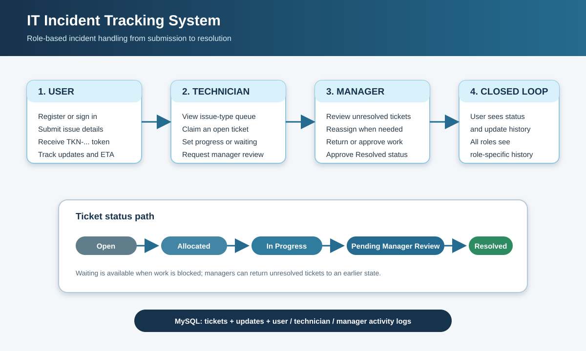

# IT Incident Tracking System

This document explains how to install, configure, run, and use the IT Incident Tracking System. The application is a Java console program backed by MySQL. It lets employees register incidents, technicians work on assigned incidents, and managers review, reassign, and resolve incidents.



## 1. What the project does

The application provides:

- Account registration and password-based login.
- Incident submission with a generated tracking token.
- Separate menus and database credentials for users, technicians, and managers.
- Ticket statuses: `Open`, `Allocated`, `In Progress`, `Waiting`, `Pending Manager Review`, and `Resolved`.
- Technician queues filtered by issue type.
- Estimated resolution times and a chronological update history.
- User, technician, and manager activity history.
- MySQL role and table permissions that limit what each application role can do.

This is a command-line application. It does not expose an HTTP server or browser interface.

## 2. Prerequisites

Install the following software before running the project:

1. **Java Development Kit 26**. The NetBeans project sets `javac.source` and `javac.target` to `26`.
2. **MySQL Server 8.0 or later**. The SQL setup uses MySQL roles, `utf8mb4`, and `IDENTIFIED BY RANDOM PASSWORD`.
3. **MySQL Connector/J 9.2.0** (or a compatible Connector/J version), available as a local JAR file.
4. **Apache NetBeans** with Java/Ant project support, or Apache Ant if building from a terminal.
5. **Git**, if you are contributing changes or pulling the project from GitHub.

The repository layout is:

```text
Tracking system/
|-- DOCUMENTATION.md
|-- README.md
|-- docs/
|   `-- incident-workflow.svg
`-- incident tracking/
    |-- database inserts/incident_tracking_setup.sql
    |-- DATABASE_SETUP.md
    |-- build.xml
    |-- nbproject/
    `-- src/
```

## 3. Get the project

Clone the repository and enter the project directory:

```powershell
git clone https://github.com/krishnachandawar/IT-incident-Tracking-system.git
Set-Location '.\IT-incident-Tracking-system\incident tracking'
```

If the repository is already open in NetBeans, open the `incident tracking` directory as an **Existing Java Project**. The project entry point is `incident.tracking.IncidentTracking`.

## 4. Set up MySQL

### 4.1 Run the complete setup script

1. Start MySQL Server.
2. Open `incident tracking/database inserts/incident_tracking_setup.sql` in MySQL Workbench.
3. Connect as a MySQL administrator.
4. Execute the entire script.
5. Save the four generated passwords shown by Workbench:
   - `incident_auth`
   - `incident_user`
   - `incident_technician`
   - `incident_manager`

The script creates the `incident_tracking` database, application tables, the `technician_directory` view, restricted roles, and the four local service accounts. It is safe to re-run for existing accounts, but it does not reset an existing account's password.

Do not commit these generated passwords or place them in source files.

### 4.2 Configure the application environment

Set the following variables in the same PowerShell window that starts the application. Replace each placeholder with the password generated by MySQL Workbench:

```powershell
$env:INCIDENT_DB_URL = "jdbc:mysql://localhost:3306/incident_tracking?serverTimezone=UTC"
$env:INCIDENT_DB_AUTH_USER = "incident_auth"
$env:INCIDENT_DB_AUTH_PASSWORD = "<incident_auth password>"
$env:INCIDENT_DB_USER_USER = "incident_user"
$env:INCIDENT_DB_USER_PASSWORD = "<incident_user password>"
$env:INCIDENT_DB_TECHNICIAN_USER = "incident_technician"
$env:INCIDENT_DB_TECHNICIAN_PASSWORD = "<incident_technician password>"
$env:INCIDENT_DB_MANAGER_USER = "incident_manager"
$env:INCIDENT_DB_MANAGER_PASSWORD = "<incident_manager password>"
```

`INCIDENT_DB_URL` is optional because the application defaults to `localhost:3306/incident_tracking`. The eight credential variables are required. The variables are process-local; set them again in every new terminal.

For NetBeans, start NetBeans from a terminal where these variables are already set, or configure them in the IDE's run environment. Also set `MYSQL_CONNECTOR_JAR` to the full path of the Connector/J JAR before opening or running the project:

```powershell
$env:MYSQL_CONNECTOR_JAR = "C:\path\to\mysql-connector-j-9.2.0.jar"
```

The project reads that variable in `nbproject/project.properties`; no machine-specific driver path should be committed.

## 5. Build and start the application

### NetBeans

1. Open the `incident tracking` folder.
2. Confirm that the MySQL Connector/J JAR is present through `MYSQL_CONNECTOR_JAR`.
3. Select **Clean and Build Project**.
4. Select **Run Project**.
5. If NetBeans asks for a main class, choose `incident.tracking.IncidentTracking`.

### Apache Ant

From the `incident tracking` directory, after setting the environment variables:

```powershell
ant clean jar
java -cp "dist\incident_tracking.jar;$env:MYSQL_CONNECTOR_JAR" incident.tracking.IncidentTracking
```

The exact Ant command depends on the Ant installation and NetBeans-generated build files. The NetBeans **Clean and Build** action is the supported path when Ant is not available on `PATH`.

At startup the program displays:

```text
Incident tracking portal
1. Register as a user
2. Log in
0. Exit
```

Choose `0` at any menu to return or exit where indicated.

## 6. First-time account setup

### Register a normal user

From the startup menu:

1. Select **1. Register as a user**.
2. Enter a unique username.
3. Enter a password of at least 12 characters.
4. Enter a unique employee ID.
5. Enter the department and designation.
6. Select **2. Log in** with the new account.

Public registration always creates the `USER` role. A registrant cannot choose `TECHNICIAN` or `MANAGER`.

### Promote staff accounts

An administrator can promote an already registered account after verifying the person:

```sql
UPDATE incident_tracking.app_users
SET role = 'TECHNICIAN'
WHERE username = 'verified-technician-login';
```

For a manager, use:

```sql
UPDATE incident_tracking.app_users
SET role = 'MANAGER'
WHERE username = 'verified-manager-login';
```

The role is read on the next login. Only authorized administrators should perform these updates.

## 7. Use the application by role

### User workflow

After logging in as `USER`, the menu contains:

1. **Register an issue**
   - Choose an issue type.
   - Enter a non-empty description.
   - The system creates a token such as `TKN-...`.
   - Save the token for support conversations and status tracking.
2. **View my tickets and updates**
   - Shows only tickets belonging to the signed-in user.
   - Displays status, technician, ETA, and the full update history.
3. **View my user activity history**
   - Shows registration and ticket events associated with the user's account.
4. **Log out**

Every new incident starts in `Open`.

### Technician workflow

After logging in as `TECHNICIAN`, the menu contains:

1. **View open issues** - view unresolved tickets.
2. **Claim an open issue**
   - Select an issue type.
   - Choose a ticket from that issue-type queue.
   - Claiming changes the ticket from `Open` to `Allocated`.
3. **Update an assigned issue or request resolution review**
   - Choose an assigned ticket.
   - Set `In Progress`, `Waiting`, or `Pending Manager Review`.
   - Enter the estimated minutes remaining and a user-facing update.
4. **View my technician activity history**
5. **Log out**

A technician can update only tickets assigned to that technician and cannot directly mark a ticket `Resolved`.

### Manager workflow

After logging in as `MANAGER`, the menu contains:

1. **View unresolved issues**
2. **Update status or approve resolution**
   - Approve a ticket as `Resolved`.
   - Return it to `In Progress`, `Waiting`, `Pending Manager Review`, or `Allocated`.
   - A resolved ticket must use an ETA of zero.
3. **Reassign an issue**
   - Enter the replacement technician ID and department.
   - Add an explanatory update for the user.
4. **View manager audit history**
5. **Log out**

Managers are the only application role allowed to approve resolution or reassign a ticket.

## 8. Ticket lifecycle

The normal lifecycle is:

```text
Open -> Allocated -> In Progress -> Pending Manager Review -> Resolved
```

`Waiting` can be used when work is blocked or information is needed. A manager can return a ticket to `Allocated`, `In Progress`, `Waiting`, or `Pending Manager Review`. Resolved tickets cannot be updated or reassigned.

### Priority ordering

Technician queues are ordered by a priority score. The implementation gives higher priority to:

- Security incidents.
- Data loss, lost data, or data corruption mentioned in the description.
- Backup and recovery incidents.
- Hardware incidents.
- Network connectivity and database connection incidents.
- Senior designations such as `SDE1` through `SDE5`.

The issue type and description should therefore be specific and accurate.

## 9. Activity history and data model

Ticket updates and activity entries are written in the same transaction. The database stores:

- `app_users` - user identity, password hash, employee data, and role.
- `tickets` - the current ticket state and assignment.
- `ticket_updates` - the chronological user-facing update stream.
- `user_activity_log` - activity visible to the requesting user.
- `technician_activity_log` - activity for the technician account.
- `manager_activity_log` - manager audit history.
- `technician_directory` - a view of technician employee IDs and departments.

The application uses a separate restricted MySQL service account for authentication and for each signed-in role. Keep all service-account credentials private. Database table permissions are not a replacement for protecting those credentials.

## 10. Troubleshooting

### Required database environment variable is not set

The application could not find one of the `INCIDENT_DB_*` variables. Set all required variables in the terminal that launches Java or NetBeans.

### Communications link failure or connection refused

Confirm that MySQL is running, the port in `INCIDENT_DB_URL` is correct, and the database setup script completed successfully.

### Access denied for user

Confirm that the password matches the generated password for the correct service account. If the account was created earlier and its password was lost, reset only that account in MySQL and update its matching environment variable.

### No suitable driver

Confirm that `MYSQL_CONNECTOR_JAR` points to a valid Connector/J JAR and that the project was restarted after changing the variable.

### Username or employee ID is already registered

Usernames and employee IDs are unique. Register with a different value or have an administrator inspect the existing record.

### Staff account still opens the user menu

Log out and log back in after the account role is changed. The role is loaded during authentication.

## 11. Security and operational notes

- Never commit generated MySQL passwords, environment files, or NetBeans private settings.
- Use a password manager or secret store for the service-account passwords.
- Do not give service-account credentials to end users or technicians.
- Use administrator access only for initial SQL setup and controlled role promotion.
- Keep MySQL and Connector/J patched.
- Back up the `incident_tracking` database before destructive maintenance.

## 12. Useful project files

- `incident tracking/database inserts/incident_tracking_setup.sql` - complete MySQL schema, roles, grants, and service accounts.
- `incident tracking/DATABASE_SETUP.md` - database-focused setup reference.
- `incident tracking/src/access/IncidentPortal.java` - console menus and database-backed workflows.
- `incident tracking/src/access/AuthenticationService.java` - registration and login.
- `incident tracking/src/access/DatabaseConnections.java` - environment variables and JDBC connections.
- `incident tracking/src/ticketing/ticketpriority.java` - queue priority rules.
- `incident tracking/nbproject/project.properties` - Java version, main class, and Connector/J classpath.
